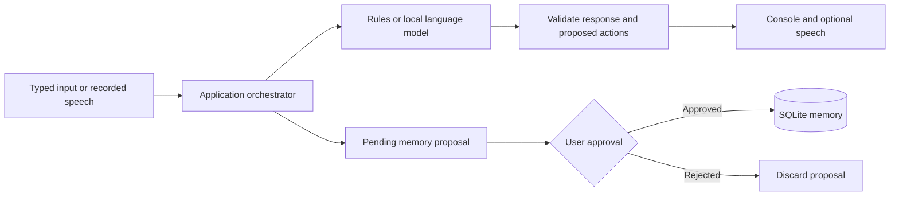

# Pet Yaya

### A hardware-independent companion robot software prototype

Pet Yaya explores how a pet-like robot can hold conversations, remember user-approved information, and develop a persistent interaction history. The project began as a companion robot idea for a younger family member. Its current focus is a working desktop prototype that can be evaluated before purchasing robot hardware.

The engineering emphasis is on separating conversational intelligence from deterministic application logic: a language model proposes a response, while the application controls memory approval, state transitions, growth tracking, cancellation, and action validation.

**Status:** software prototype; Chinese-language interaction; Windows voice integration; no physical robot connected. This is not a finished consumer product or a validated child-safety system.

## Explore the prototype

Start with the [two-minute rules-only demo](DEMO.md) to inspect memory approval without installing a language model. Then read the [architecture](PROJECT_STRUCTURE.md) or the [recorded verification scope](TESTING.md). Voice and local-model integration are optional extensions.



The diagram describes the software architecture. It does not depict a connected physical robot.

## Documentation

- [Project structure and architecture](PROJECT_STRUCTURE.md)
- [Installation and running](RUNNING.md)
- [Testing and demonstration](TESTING.md)
- [Next steps and acceptance criteria](ROADMAP.md)

This repository contains the runnable software prototype, automated tests, launch scripts and English documentation. Run commands from this repository's `software/` directory as described below. Personal databases, recordings, credentials, downloaded model weights and virtual environments are intentionally excluded; optional dependencies and models must be installed locally.

## Current capabilities

| Area | Implemented behavior | Boundary |
| --- | --- | --- |
| Dialogue | Local LM Studio adapter, Qwen-based dialogue, short conversation context, follow-up style requests, streamed text | Model responses can still be inaccurate; the interface is primarily Chinese |
| Fallback | Deterministic rule-based responses and provider diagnostics | A fallback response is not proof that the model is working; check `/model` |
| Memory | Explicit and contextual memory requests, pending approval, natural-language confirmation, listing and deletion, SQLite persistence | Long-term storage requires approval; semantic intent recognition is not infallible |
| Growth | Persistent interaction count, growth points, threshold-based skill identifiers | Application state, not online model training or autonomous learning |
| Voice | Microphone recording, local faster-whisper recognition, persistent recognition worker, optional CUDA acceleration, Windows speech synthesis | Recording begins with `/listen`; no always-listening wake word or full-duplex conversation |
| Turn-taking | Speech-end detection, adjustable pause threshold, optional transcript review | Speech recognition currently follows recording rather than continuously transcribing live audio |
| Interruption | Cancel recording, recognition, generation, or speech playback | Stopping playback preserves an already completed response; incomplete generation is not committed |
| Simulated embodiment | Whitelisted actions, emotion labels, virtual battery, touch, collision, mute and network events | Console output only; no motors, navigation, or measured physical safety |

## Quick start: no model or hardware required

Use a normal Python installation, version 3.11 or newer. Python 3.12.14 was used for the latest local test run. In PowerShell, from the source repository root:

```powershell
cd software
py -3.12 -m venv .venv
$env:PET_YAYA_DIALOGUE_MODE = "rules"
.\.venv\Scripts\python.exe -X utf8 launch_simulator.py
```

If Python 3.12 is not installed, select an installed Python version meeting the minimum requirement. The rules-only core has no declared third-party runtime dependencies. For model-backed conversation and optional voice, follow [RUNNING.md](RUNNING.md).

Inside the simulator:

```text
/help
请记住，我喜欢恐龙
/yes
/memory
/growth
/quit
```

The sentence means “Please remember that I like dinosaurs.” This small demonstration exercises the pending-memory and approval workflow without requiring a language model.

## Verification snapshot

On **2026-09-11**, the automated suite was rerun from this source snapshot on Windows with Python 3.12.14 and the existing development dependencies: **122 tests passed**. Rules-only memory approval and persistence were also checked with a temporary database. Without site-packages, the suite runs with 5 optional-dependency tests skipped. These are unit/regression results, not measurements of speech accuracy, hardware reliability, or complete test coverage. Live microphone and model integration checks were not rerun during snapshot preparation. See [TESTING.md](TESTING.md) for reproducible commands and manual acceptance checks.

## Limitations and responsible use

- A complete text response is generated before speech synthesis starts; sentence-by-sentence playback is planned.
- Speech errors and language-model hallucinations remain possible. The system should ask for clarification rather than invent facts, but this behavior is not guaranteed.
- Memory and growth are application features, not evidence of sentience, genuine emotions, or model-weight adaptation.
- Persistent state is stored in a local SQLite database. Local storage should not be interpreted as encryption or a comprehensive privacy guarantee.
- Local mode is intended to use a loopback model server. Changing the endpoint or enabling a remote provider changes where conversation data is processed.
- Physical hardware integration, security hardening, and systematic user evaluation are future work.

## Next milestone

Reduce perceived voice-response latency with cancellable sentence-level speech output, while preserving the existing distinction between previewed text and committed conversation state. The [roadmap](ROADMAP.md) defines this and subsequent milestones without claiming they are already implemented.


---

## 中文导览

Pet Yaya 是与硬件解耦的陪伴机器人软件原型，目前以中文交互为主，尚未连接实体机器人。项目把模型生成与确定性的记忆审批、状态更新、取消和动作校验分开。

- [两分钟演示](DEMO.md)：不用模型或硬件，检查记忆提出、批准和持久化。
- [运行指南](RUNNING.md)：规则模式、本地模型与可选语音。
- [架构说明](PROJECT_STRUCTURE.md)：模块关系和关键设计选择。
- [测试记录](TESTING.md)：现有自动化测试的范围及边界；不是本次文档更新重新执行的测试结果。

历史发布准备记录保留在 [GITLAB_PREPARATION.md](GITLAB_PREPARATION.md)，不作为启动入口。
